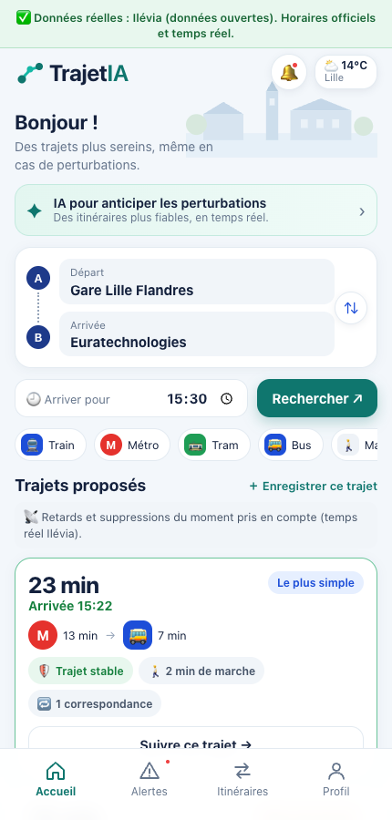
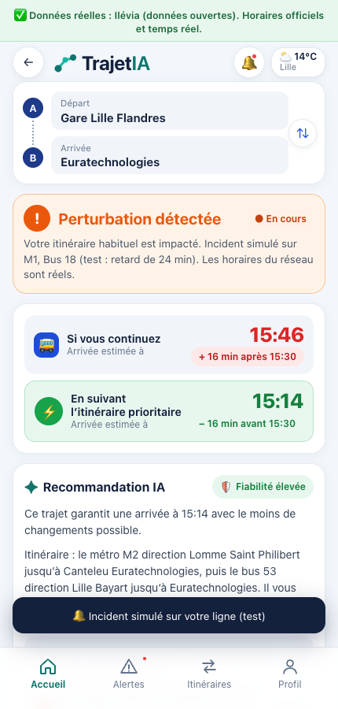
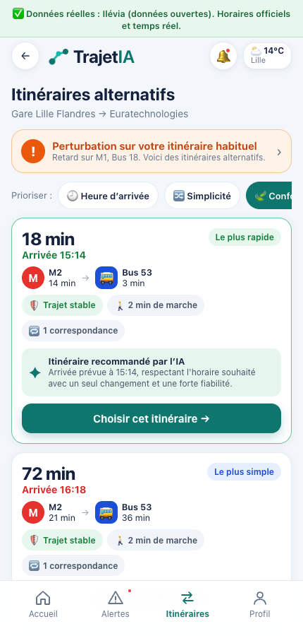
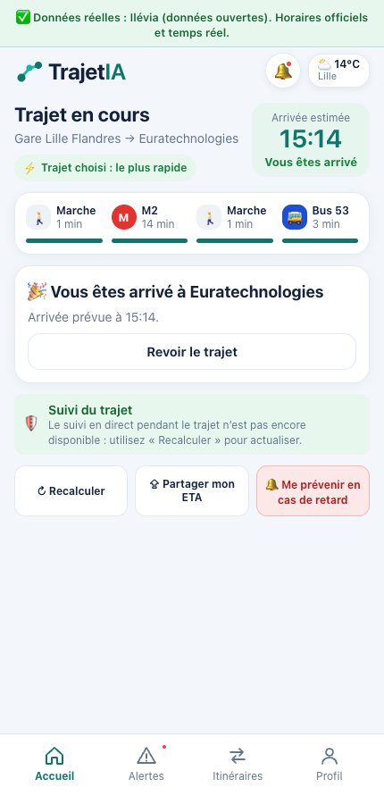
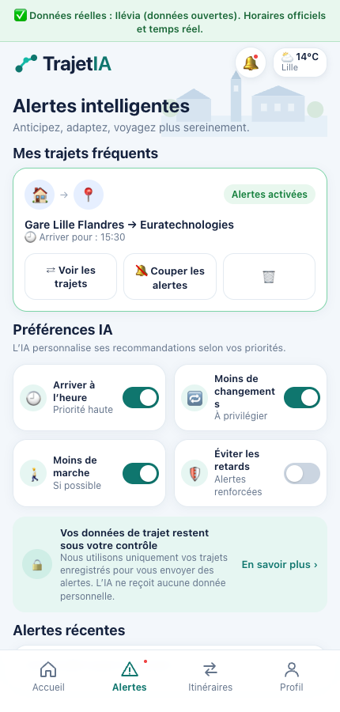
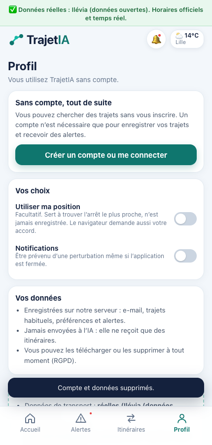

# TrajetIA : dossier technique et rapport de tests

*Équipe 2. Document généré automatiquement le 3 novembre 2026 à 14:20 à partir des tests réels (`npm run rapport`). Pour comprendre le fonctionnement de l'application fichier par fichier, lisez `COMPRENDRE.md`.*

> **En une phrase :** TrajetIA prévient un voyageur quand son trajet est perturbé, lui dit à quelle heure il arrivera vraiment, et lui propose une alternative recommandée par une IA, avec de **vraies données** du réseau de transport de Lille (Ilévia), sans clé payante.

## 1. Résultat des tests, en bref

| | |
|---|---|
| Tests automatiques du serveur | **42 / 42** réussis |
| Test complet de l'application dans un vrai navigateur (Chrome), de A à Z | **84 / 84** vérifications réussies, en 63 s |
| Données de transport | **réelles** : horaires officiels Ilévia + retards en temps réel + adresses de l'État |
| IA | **réelle** : Groq (modèle `qwen/qwen3.8-27b`, offre gratuite), appelée à chaque perturbation, **250 à 310 ms**, avec plan B au-delà de 3 s |
| Notifications | **réelles** : envoyées par le serveur, reçues dans le navigateur |
| Position | **réelle** : coordonnées du navigateur → arrêts les plus proches, avec consentement |
| Mode `npm run dev` (celui que vous lancez au quotidien) | **14 / 14** dans Chrome (Vite + proxy), y compris le plan B quand l'IA est lente |
| Installation neuve (copie sans `.env`, sans données, sans `node_modules`) | installation + build + **42 / 42** tests + **14 / 14** dans Chrome : l'application marche sur un autre ordinateur |

Ce qui n'a **pas** pu être testé est listé honnêtement en section 8.

## 2. Comment lancer (de A à Z)

```bash
cd trajetia
npm install      # une seule fois
npm run dev      # lance le serveur ET l'application
```

Puis ouvrir **http://localhost:5173** dans Chrome. Au premier démarrage, le serveur télécharge les horaires du réseau (9,5 Mo) : le bandeau du haut affiche « Chargement des horaires… » puis devient vert : « Données réelles : Ilévia ». Aucune connexion n'est demandée pour utiliser l'application ; un compte (e-mail + mot de passe de 10 caractères minimum) n'est demandé qu'au moment d'enregistrer un trajet.

Le fichier `.env` (jamais publié) contient la clé de l'IA et les clés des notifications. Modèle : `.env.example`.

## 3. Ce que le dossier d'équipe demandait, et où le trouver

| Ce que disent nos PDF | Dans l'application | Preuve |
|---|---|---|
| Informer vite d'une perturbation sur son trajet | Détection automatique d'un retard ou d'une suppression sur le trajet habituel, alerte + notification | sections 7 et 6 du test complet |
| Estimation de l'heure réelle d'arrivée | « Si vous continuez » contre la meilleure alternative, avec les retards du moment | section 4 |
| Centralisation des informations | Un seul endroit : horaires officiels, temps réel, adresses | section 1 |
| Itinéraires alternatifs et comparaison | Écran « Itinéraires alternatifs » avec priorités Heure d'arrivée / Simplicité / Confort | section 4 |
| Personnalisation selon le trajet | Trajets enregistrés, préférences IA (arriver à l'heure, moins de changements, moins de marche, éviter les retards) | section 5 |
| L'IA compare et recommande ; elle n'invente ni trajet ni horaire | Le serveur vérifie sa réponse (trajet existant, heure exacte, aucune heure inventée) | tests automatiques |
| L'IA ne reçoit aucune donnée personnelle | Elle ne reçoit que des itinéraires (testé : aucune fuite d'e-mail ni de position) | tests automatiques |
| Délai de 3 secondes maximum, sinon les alternatives restent affichées | Plan B : alternatives classées par heure d'arrivée | section 10 |
| L'IA n'est appelée que lorsqu'une perturbation touche un trajet ; résultats réutilisés | Un résultat identique n'est pas redemandé ; chaque appel est journalisé (coût suivi) | tests automatiques, section 11 |
| Découverte sans compte, puis inscription pour enregistrer son trajet | Tout fonctionne sans compte ; la fenêtre d'inscription s'ouvre au moment d'enregistrer | section 5 |
| Mesurer d'où viennent les utilisateurs (QR code, lien) | `?src=gare` ou `?src=video` est mémorisé ; conversion par canal calculée | section 11 |
| North Star Metric et 3 KPI (activation, conversion par canal, rétention à 7 jours) | Tableau de bord protégé `/api/admin/kpis` | section 11 |
| Localisation facultative, suppression des données (RGPD) | Position avec interrupteur et accord du navigateur ; export et suppression du compte | sections 3 et 8 |
| Incertitude n°1 : fraîcheur des données des opérateurs | **Mesurée** : le flux temps réel d'Ilévia a de 6 à 10 secondes ; le Profil le mesure en direct | section 8 |
| Incertitude n°2 : choix et coût du fournisseur d'IA | Gemini gratuit testé : 0,5 à 1,2 s. **Limite découverte : environ 20 requêtes par jour sur le modèle testé en premier** (voir section 7) | section 11 |
| Prototype Lovable (5 écrans) | Les 5 écrans sont reproduits : Accueil, Perturbation détectée, Itinéraires alternatifs, Trajet en cours, Alertes intelligentes | captures ci-dessous |

## 4. Les écrans

| Accueil | Perturbation et IA | Alternatives |
|---|---|---|
|  |  |  |

| Trajet en cours | Alertes | Profil |
|---|---|---|
|  |  |  |

## 5. Architecture

```
Navigateur (React)                    Serveur Node (Express)                          Données RÉELLES (sans clé)
┌──────────────────────┐   HTTPS   ┌─────────────────────────────────────┐
│ 5 écrans + Profil    │──────────►│ Comptes (cookie httpOnly)           │
│ Service worker (push)│           │ Trajets, préférences, alertes       │◄── Horaires officiels Ilévia (GTFS)
│ Position (accord)    │◄──────────│ Calculateur d'itinéraires           │◄── Retards/suppressions (GTFS-RT)
└──────────────────────┘           │  (Connection Scan + correspondances)│◄── Adresses (Base Adresse Nationale)
                                   │ Contrôle de l'IA + plan B           │──► IA : Google Gemini (gratuit)
                                   │ Surveillance toutes les 5 min       │──► Notifications push (clés VAPID, gratuit)
                                   │ Mesures (KPI) · base SQLite         │
                                   └─────────────────────────────────────┘
```

- **Le calculateur d'itinéraires est notre propre code** (`server/providers/gtfs.js`) : il lit les horaires officiels, applique les retards et suppressions du moment, relie les arrêts proches à pied, et cherche l'arrivée la plus tôt (algorithme *Connection Scan*). En cas de perturbation, il refait le trajet habituel aux horaires réels et cherche des alternatives qui évitent les lignes touchées.
- **Séparation claire** : `server/` (comptes, trajets, itinéraires, IA, notifications, surveillance, mesures), `src/` (écrans React), `public/sw.js` (notifications), `scripts/` (lanceur et tests).

## 6. Les données et services utilisés

| Service | Rôle | Clé / coût | Réel et testé ? |
|---|---|---|---|
| Horaires GTFS Ilévia | horaires officiels | gratuit, sans clé | ✅ |
| Flux GTFS-RT Ilévia | retards et suppressions | gratuit, sans clé | ✅ (flux de 6 à 10 s) |
| Base Adresse Nationale | adresses | gratuit, sans clé | ✅ |
| Groq (`qwen/qwen3.8-27b`) | recommandation par IA | gratuit : 1000 requêtes/jour, 8000 jetons/minute | ✅ 250 à 310 ms |
| Google Gemini (alternative) | recommandation par IA | gratuit mais limité (20 requêtes/jour) et lent par moments | ✅ testé, déconseillé |
| Notifications push (VAPID) | alertes | gratuit | ✅ dans Chrome |
| Navitia (optionnel) | SNCF et autres villes | jeton gratuit | ❌ non testé (pas de jeton) |

## 7. Découvertes importantes faites en testant

**Quota de l'IA gratuite.** L'offre gratuite de Gemini a limité le modèle `gemini-2.5-flash-lite` à **20 requêtes par jour** (message d'erreur reçu : « limit: 20 … per day »). Chaque modèle a son propre quota. Nos essais ont épuisé celui-là : l'application a alors affiché son plan B, comme prévu. Réponse : le serveur accepte **plusieurs modèles** (`AI_MODEL=a,b,c`) et passe au suivant dès qu'un modèle répond « quota épuisé » (testé). **Avant la présentation, ne relancez pas le test complet** : il consomme quelques requêtes.

**Vitesse de l'IA gratuite : très variable.** Le matin, Gemini répondait en 0,5 à 1,2 s. Plus tard dans la journée, les mêmes appels mettaient 15 à 20 s (service gratuit partagé, ou limitation après nos essais). L'application a réagi exactement comme prévu par notre dossier : au-delà de 3 s, elle affiche le plan B (alternatives classées par heure d'arrivée). **Réponse apportée** : l'application utilise maintenant **Groq** (`qwen/qwen3.8-27b`), mesuré à 250-310 ms avec 1000 requêtes gratuites par jour. Une capture d'écran de l'écran avec la phrase de l'IA reste utile en secours.

**Défauts trouvés par les tests et corrigés :**

1. Effacer le champ « Arrivée » gardait l'ancien lieu en silence pour la recherche.
2. Une limite de débit posée sur les routes de recherche s'appliquait aussi aux routes suivantes (mesures, notifications, administration) ; idem pour l'IA. Une limite est maintenant attachée à sa propre route (test de non-régression ajouté).
3. Les alertes créées par le serveur pendant que l'application était ouverte n'apparaissaient qu'après rechargement : l'écran Alertes se rafraîchit à l'ouverture.
4. Sur un téléphone étroit (390 px), les cartes de préférences dépassaient de 3 pixels.
5. Plus tôt dans le projet : un contrôle de connexion posé sur un routeur s'appliquait à toutes les routes suivantes.
6. Une icône de page manquante provoquait une erreur 404 dans la console en mode `npm run dev` : ajoutée.

## 8. Ce qui n'a pas pu être testé, et les limites

- **La vitesse de l'IA gratuite** n'est pas garantie (voir section 7) : le plan B peut s'afficher à la place de la phrase de l'IA.
- **Téléphone réel** : tous les tests sont faits dans Chrome sur ordinateur (avec un affichage mobile simulé de 390 px). Les notifications et la position n'ont pas été essayées sur un vrai téléphone.
- **Affichage système de la notification** : le navigateur la reçoit et la déclare ; je n'ai pas vérifié visuellement la bannière macOS.
- **Une seule ville** : Lille (Ilévia). Paris, Lyon et les trains SNCF demandent un jeton Navitia ou le branchement d'autres données ouvertes.
- **La marche est estimée** (vol d'oiseau × 1,3 à 4,5 km/h), pas calculée sur les trottoirs.
- **Le temps réel donne des retards et des suppressions, pas la cause** (le flux ne contient aucun message d'alerte). L'application ne dit jamais une cause qu'elle ne connaît pas.
- **L'incident est simulé** par le bouton « Tester : simuler un incident sur ma ligne » (les horaires et itinéraires restent réels). Une vraie panne a pu être observée dans le flux (retards jusqu'à 43 min), mais pas pendant le test de bout en bout.
- **Les trajets de demain** utilisent les horaires officiels : le temps réel ne concerne que le jour même.
- **Suivi pendant le trajet** : l'écran « Trajet en cours » avance à la main (pas de suivi GPS ni de carte).
- **Réinitialisation du mot de passe par e-mail** : non faite (il faut un service d'envoi d'e-mails).
- **Non faits** : tests de charge, sauvegardes de la base, supervision, mentions légales et politique de confidentialité, audit d'accessibilité complet (seul un contrôle de base est automatisé).
- **Production** : le démarrage en mode production (cookie sécurisé, en-têtes, refus sans secret) est testé en local ; le déploiement sur un hébergeur n'a pas été fait. Le Dockerfile n'a pas été testé.

## 9. Sécurité et vie privée

Mots de passe hachés (bcrypt) ; session en cookie `httpOnly` + `SameSite=Strict` (+ `Secure` en production) ; refus des requêtes venues d'un autre site ; limitation des tentatives de connexion et des appels coûteux ; en-têtes de sécurité (HSTS, CSP, nosniff) ; chaque donnée filtrée par utilisateur ; l'IA ne reçoit que des itinéraires ; la position n'est jamais enregistrée ; export et suppression du compte ; secrets uniquement dans `.env` (jamais publié) ; en production, le serveur refuse de démarrer sans `JWT_SECRET`.

À savoir : l'offre gratuite d'un fournisseur d'IA peut utiliser les données envoyées pour s'améliorer ; ici, seules des alternatives d'itinéraires sont envoyées, jamais de donnée personnelle.

## 10. Résultats détaillés du test complet

Le script `scripts/e2e-complet.mjs` démarre ses propres serveurs, ouvre un vrai Chrome (avec géolocalisation, notifications et presse-papiers autorisés) et utilise l'application comme un vrai utilisateur : il tape dans les champs, clique sur les boutons, crée un compte, recharge la page, redémarre le serveur, etc.

### 0. Démarrage des serveurs de test

| | Vérification | Résultat observé |
|---|---|---|
| ✅ | serveur principal démarré (données Ilévia réelles, IA Gemini, notifications) | TrajetIA : http://localhost:3097 /   IA : generativelanguage.googleapis.com · gemini-flash-lite-latest /   notifications : actives |
| ✅ | serveur « IA trop lente » démarré (délai de 1 ms pour provoquer le plan B) |  |

### 1. Démarrage et accueil

| | Vérification | Résultat observé |
|---|---|---|
| ✅ | bandeau « Données réelles : Ilévia » |  |
| ✅ | trajet d’exemple pré-rempli (Gare Lille Flandres → Euratechnologies) | Gare Lille Flandres → Euratechnologies |
| ✅ | des trajets réels sont affichés | 4 trajets |
| ✅ | note sur le temps réel affichée |  |
| ✅ | heure d’arrivée par défaut proche de « maintenant + 1 h » | 15:30 |

### 2. Recherche de lieux et de trajets

| | Vérification | Résultat observé |
|---|---|---|
| ✅ | suggestions d’arrêts réelles pour « republique » | République Beaux-Arts |
| ✅ | recherche avec un nouveau départ : des trajets s’affichent |  |
| ✅ | suggestions pour « euratech » | Euratechnologies |
| ✅ | bouton ⇅ : départ et arrivée inversés | Euratechnologies ↔ République Beaux-Arts |
| ✅ | changement de l’heure d’arrivée puis recherche |  |
| ✅ | adresse réelle (Base Adresse Nationale) proposée et utilisable comme arrivée | 10 Rue Nationale 59800 Lille |
| ✅ | arrivée vide : message clair au lieu d’une erreur |  |

### 3. Utiliser ma position (géolocalisation avec consentement)

| | Vérification | Résultat observé |
|---|---|---|
| ✅ | interrupteur « position » désactivé par défaut |  |
| ✅ | bouton 📍 absent tant que la position n’est pas autorisée |  |
| ✅ | après consentement : bouton 📍 visible |  |
| ✅ | bouton 📍 : le départ devient « Ma position » (coordonnées du navigateur) |  |
| ✅ | recherche de trajets depuis « Ma position » (marche jusqu’à l’arrêt incluse) | 4 trajets |
| ✅ | arrêts réels les plus proches de la gare (position 1) | Ma position, Gare Lille Flandres, Lycee Pasteur, Gare Rue De Tournai, Gare Lille Europe, Lion D'Or |
| ✅ | arrêts réels les plus proches d’Euratechnologies (position 2) | Ma position, Euratechnologies, Martyrs, Le Pont, Canteleu Euratechnologies, Canteleu |
| ✅ | la position n’est jamais mémorisée côté navigateur |  |
| ✅ | position refusée par l’utilisateur : message clair, rien ne casse |  |

### 4. Incident simulé, vraie IA, alternatives, trajet en cours

| | Vérification | Résultat observé |
|---|---|---|
| ✅ | écran « Perturbation détectée » (incident simulé annoncé comme tel) |  |
| ✅ | recommandation par la VRAIE IA (Gemini) affichée | « Ce trajet garantit une arrivée à 15:14 avec le moins de changements possible. » |
| ✅ | la phrase de l’IA ne contient pas d’identifiant technique |  |
| ✅ | « Si vous continuez » comparé à la meilleure alternative |  |
| ✅ | détail de la perturbation affiché |  |
| ✅ | priorités Heure d’arrivée / Simplicité / Confort : la liste se met à jour | avant=18 min,72 min simplicité=18 min,72 min |
| ✅ | trajet en cours affiché avec l’heure d’arrivée |  |
| ✅ | « Étape terminée » : la progression va jusqu’à l’arrivée | 4 étapes |
| ✅ | « Partager mon heure d’arrivée » : copiée dans le presse-papiers | J’arrive à 15:14 (TrajetIA) |
| ✅ | « Recalculer » : trajets actualisés |  |

### 5. Compte, trajets enregistrés, préférences

| | Vérification | Résultat observé |
|---|---|---|
| ✅ | sans compte : la demande de compte s’ouvre seulement au moment d’enregistrer |  |
| ✅ | inscription (e-mail + mot de passe) puis trajet enregistré | test-1793711990073@exemple.fr |
| ✅ | session ouverte (cookie httpOnly, invisible du JavaScript de la page) |  |
| ✅ | écran Alertes : le trajet enregistré apparaît |  |
| ✅ | couper puis réactiver les alertes d’un trajet |  |
| ✅ | « Voir les trajets » rouvre la recherche de ce trajet enregistré |  |
| ✅ | préférences IA enregistrées sur le serveur et retrouvées après rechargement | {"Arriver à l’heure":"true","Moins de changements":"true","Moins de marche":"true","Éviter les retards":"false"} |
| ✅ | session conservée après rechargement de la page |  |
| ✅ | déconnexion |  |
| ✅ | inscription avec un e-mail déjà utilisé : refusée avec un message clair |  |
| ✅ | connexion avec un mauvais mot de passe : refusée (message générique) |  |
| ✅ | reconnexion avec le bon mot de passe |  |
| ✅ | après reconnexion : trajets et préférences retrouvés |  |
| ✅ | suppression d’un trajet enregistré |  |

### 6. Notifications push (réelles)

| | Vérification | Résultat observé |
|---|---|---|
| ✅ | activation des notifications (abonnement push créé) |  |
| ✅ | abonnement présent dans le navigateur |  |
| ✅ | notification de test envoyée par le serveur ET reçue par le navigateur | reçue en 1 s |

### 7. Surveillance automatique d’un trajet (alerte + notification)

| | Vérification | Résultat observé |
|---|---|---|
| ✅ | trajet à arriver dans 4 minutes enregistré (impossible à tenir : sert à déclencher l’alerte) | arriver pour 14:24 |
| ✅ | le serveur surveille le trajet et crée une alerte tout seul | Perturbation sur « Trajet surveillé (test) » : Arrivée estimée 14:44 au lieu de 14:24. Ouvrez TrajetIA pour voir les alternatives. |
| ✅ | la notification de l’alerte automatique est reçue | reçue en 1 s |
| ✅ | pas de doublon : une seule alerte par trajet, jour et type | 1 → 1 |
| ✅ | l’alerte apparaît dans « Alertes récentes » |  |

### 8. Profil, fraîcheur des données, export et suppression (RGPD)

| | Vérification | Résultat observé |
|---|---|---|
| ✅ | fraîcheur RÉELLE du flux temps réel mesurée | 6 s, 345 courses suivies |
| ✅ | état des services exact (données réelles, IA active, notifications configurées) |  |
| ✅ | export RGPD : toutes les données de la personne | 1 trajet(s), 1 alerte(s) |
| ✅ | bouton « Télécharger mes données » sans erreur |  |
| ✅ | suppression du compte : session fermée et connexion impossible |  |

### 9. Affichage mobile et accessibilité de base

| | Vérification | Résultat observé |
|---|---|---|
| ✅ | mobile (390 px) : aucun défilement horizontal | débordement : 0px |
| ✅ | mobile : écran « accueil » sans débordement | 0px |
| ✅ | mobile : écran « alertes » sans débordement | 0px |
| ✅ | mobile : écran « itineraires » sans débordement | 0px |
| ✅ | mobile : écran « profil » sans débordement | 0px |
| ✅ | boutons et champs : tous ont un nom accessible |  |
| ✅ | langue de la page déclarée (fr) |  |

### 10. Plan B : l’IA ne répond pas dans le délai

| | Vérification | Résultat observé |
|---|---|---|
| ✅ | IA trop lente : message clair + alternatives classées par heure d’arrivée |  |
| ✅ | les alternatives restent disponibles et triées | 15:22 < 15:34 |

### 11. Performances, sécurité, indicateurs

| | Vérification | Résultat observé |
|---|---|---|
| ✅ | recherche de lieux (arrêts + adresses de l’État) : temps de réponse médian < 1500 ms | 157 ms (premières requêtes, avant mise en mémoire) |
| ✅ | calcul d’itinéraires réels : temps de réponse médian < 1500 ms | 60 ms |
| ✅ | IA (Gemini) : temps de réponse médian < 3000 ms (limite de votre PDF) | 792, 592 ms |
| ✅ | sécurité : trajets inaccessibles sans connexion (401) |  |
| ✅ | sécurité : requête venue d’un autre site refusée (403) |  |
| ✅ | sécurité : tableau de bord des KPI refusé sans jeton (401) |  |
| ✅ | KPI : visiteurs, North Star et conversion par canal « gare » mesurés | visiteurs=1, North Star=2, activation=1, canal gare={"visiteurs":1,"actives":1,"tauxConversion":1} |
| ✅ | santé du service : source, IA et notifications annoncées | {"source":"Ilévia (données ouvertes)","ia":"generativelanguage.googleapis.com · gemini-flash-lite-latest","push":true} |

### 12. Persistance après redémarrage et mode production

| | Vérification | Résultat observé |
|---|---|---|
| ✅ | après redémarrage du serveur : le compte et le trajet sont toujours là (base SQLite) |  |
| ✅ | mode production : cookie de session HttpOnly + Secure + SameSite=Strict |  |
| ✅ | mode production : en-têtes de sécurité (HSTS, CSP, nosniff) |  |
| ✅ | mode production : le même serveur sert l’application construite |  |
| ✅ | mode production : le serveur refuse de démarrer sans JWT_SECRET |  |

### 13. Erreurs JavaScript et réseau pendant tout le parcours

| | Vérification | Résultat observé |
|---|---|---|
| ✅ | aucune erreur JavaScript dans la console (hors refus attendus des tests négatifs : 401, 409) | [principal] Failed to load resource: the server responded with a status of 409 (Conflict) / [principal] Failed to load resource: the server responded with a status of 401 (Unauthorized) / [principal] Failed to load resou |
| ✅ | aucune requête réseau en échec inattendue |  |

## 11. Rejouer les tests

```bash
npm test               # 42 tests automatiques du serveur (sans consommer le quota de l'IA)
npm run test:complet   # parcours complet dans Chrome (consomme quelques requêtes de l'IA gratuite)
npm run rapport        # régénère ce document
```

## 12. Pour la démonstration

1. `npm run dev`, attendre le bandeau vert.
2. **Accueil** : montrer la recherche (arrêts et adresses réels), le bouton ⇅, l'heure d'arrivée.
3. **Tester : simuler un incident** : « Si vous continuez » contre la meilleure alternative, et la phrase de l'IA.
4. Expliquer : l'IA ne reçoit que des itinéraires, le serveur vérifie sa réponse, plan B au-delà de 3 secondes, appel seulement en cas de perturbation.
5. **Voir d'autres options** (priorités), **Choisir**, **Trajet en cours**.
6. **Enregistrer ce trajet** (création de compte au dernier moment), **Alertes**, **Profil** (état des services, fraîcheur mesurée, export, suppression).
7. Honnêteté : une ville, incident simulé, marche estimée, pas testé sur téléphone.
